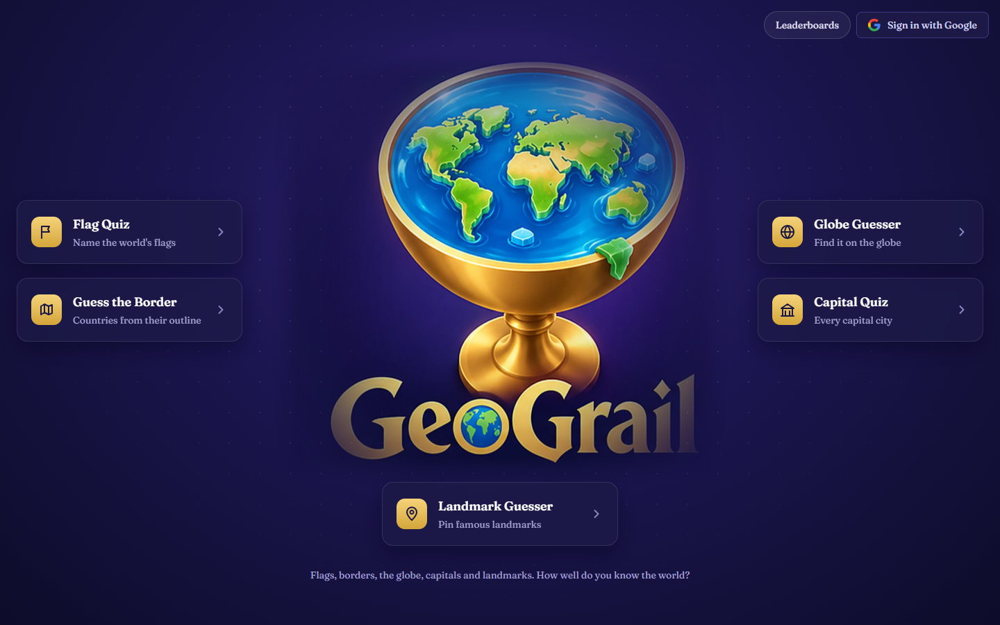
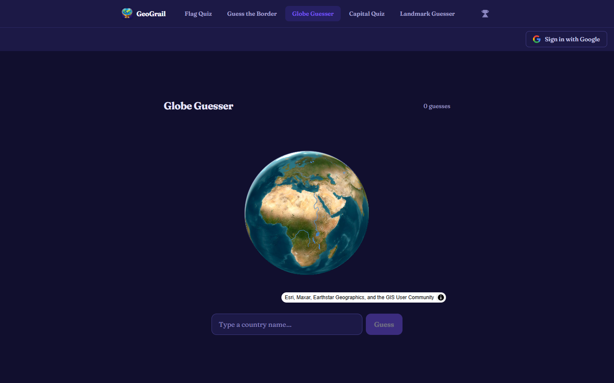

# GeoGrail

**Play it: [geograil.vercel.app](https://geograil.vercel.app)**

A geography game with five ways to play, a real 3D globe, Google sign-in, friends and leaderboards. I started it to teach myself web development and kept building until it became a full product: 64 commits, a typed Next.js app, a Postgres backend with row-level security, and around 750 hand-checked flags, capitals and landmarks.



## The five modes

| Mode | How it works |
|---|---|
| **Flag Quiz** | Name all 196 world flags in 15 minutes. Answers are checked as you type, with no submit button, and you can skip and come back. |
| **Guess the Border** | See a country's silhouette and name it in six tries. Each wrong guess shows how far away it is and in which direction. |
| **Globe Guesser** | Find a mystery country on a 3D satellite globe. Every guess is ranked by its distance from the target's nearest border, so you close in. |
| **Capital Quiz** | Every capital city, against the clock. |
| **Landmark Guesser** | Ten famous landmarks per round, drawn from about 550. Drop a pin on the globe, and you're ranked by your average distance off. |



## What makes it good

- **It forgives typos, not ignorance.** Answers are matched with a Levenshtein edit-distance check scaled to the word's length, plus aliases ("USA", "Côte d'Ivoire" / "Ivory Coast"). A slip gets through, and a wrong country doesn't.
- **A real globe, not a flat map.** Globe and Landmark modes run on MapLibre GL with satellite imagery, rivers and lakes. Distances are great-circle distances from the nearest point on a country's border, not from its centre, so big countries aren't unfairly easy.
- **Geometry built offline.** `scripts/buildPolygons.mjs` turns Natural Earth TopoJSON into two committed GeoJSON files: 10m resolution for shapes and distance maths, and a 50m version about a fifth the size for the globe. The game never calls an external geography API at runtime.
- **Accounts that matter.** Google sign-in through Supabase Auth, a username step on first sign-in, profiles, per-mode personal bests and stats with a continent breakdown.
- **Friends and leaderboards.** Search for players, send and accept friend requests, and compare on global or friends-only leaderboards for every mode.
- **Security in the database, not just the UI.** Every table has Postgres row-level security policies, and the browser only ever holds the public anon key. Game results are written through server API routes.
- **It stays up.** A GitHub Actions job reads real rows and pings Supabase Auth twice a day, so the free-tier database never pauses.
- **Works on a phone.** Layouts and inputs are built mobile-first.

## Stack

Next.js 15 (App Router) · React 18 · TypeScript · Tailwind CSS · Supabase (Postgres, Auth, RLS) · MapLibre GL · topojson-client / world-atlas · Vercel · GitHub Actions

## Project layout

```
src/
  app/            pages and API routes (leaderboard, friends, save-game-result, user-stats, auth)
  components/     one component per mode, plus globe/, landmark/, worldle/ and auth/
  data/           countries, capitals and landmarks
  lib/            fuzzy matching, country resolution, geo maths, Supabase clients
supabase/migrations/   schema, RLS policies, friends, per-mode stats
scripts/buildPolygons.mjs   generates the country geometry in public/
```

## Run it locally

```bash
npm install
npm run dev
```

Create `.env.local` with:

```
NEXT_PUBLIC_SUPABASE_URL=...
NEXT_PUBLIC_SUPABASE_ANON_KEY=...
```

Apply the SQL in `supabase/migrations/` to your Supabase project, and enable Google as an auth provider. The country geometry is already committed. Run `npm run build:polygons` only if you want to regenerate it.

## Author

Built by [Hugh Archer](https://hugharcher.vercel.app).
